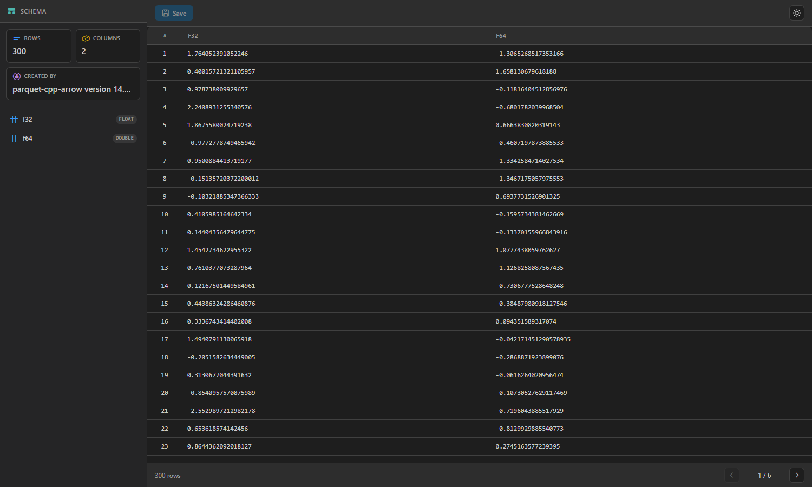
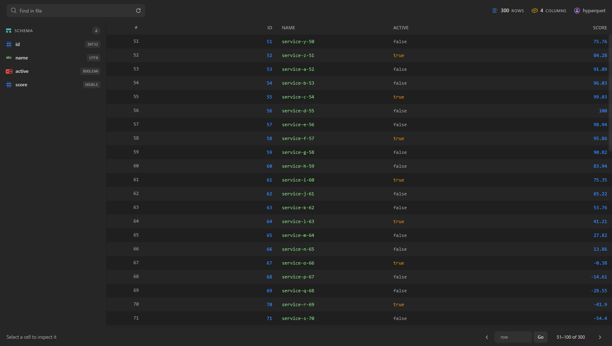
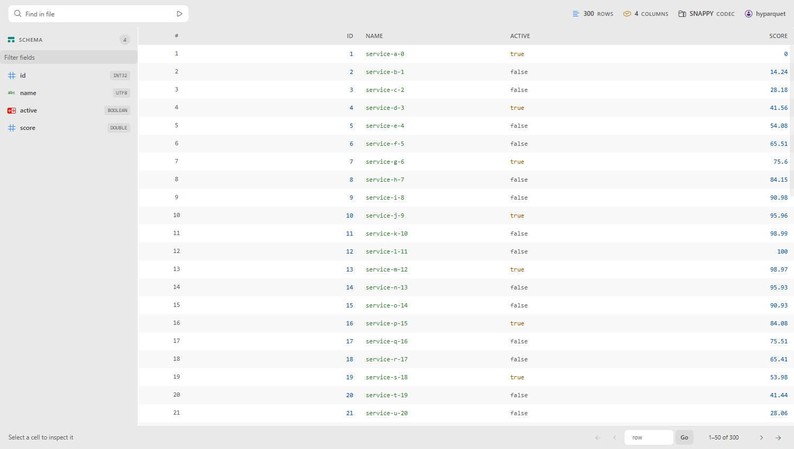
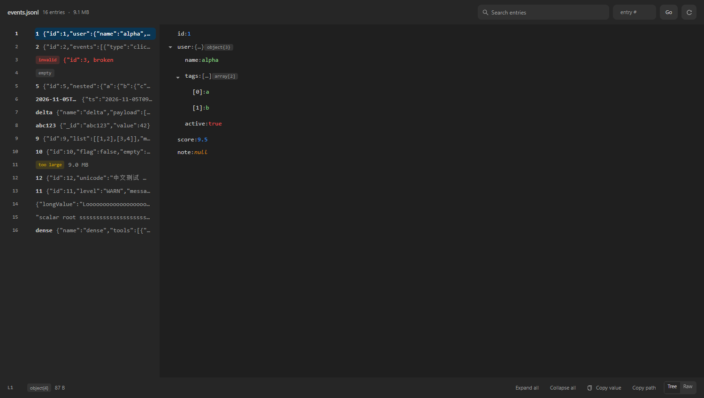
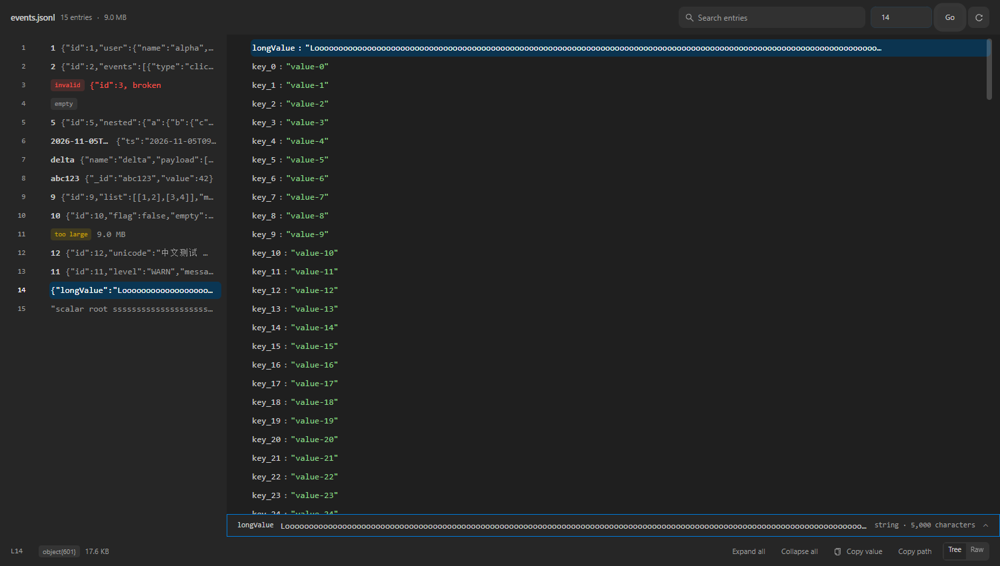
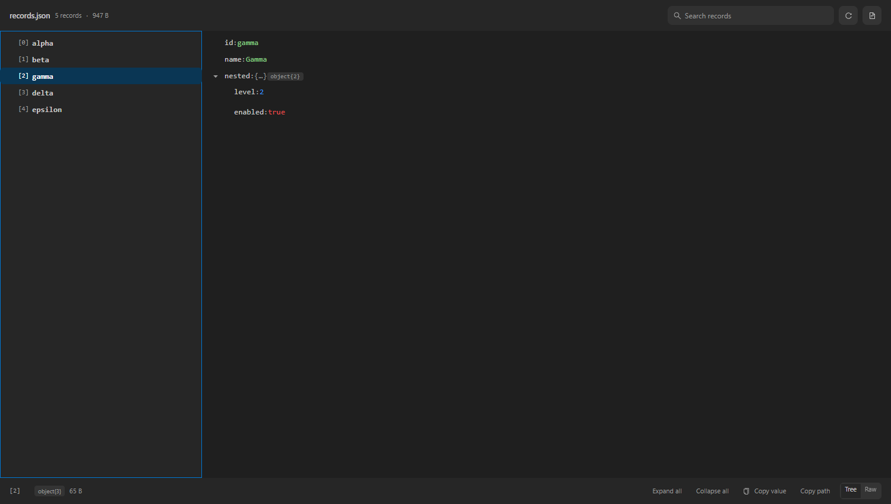
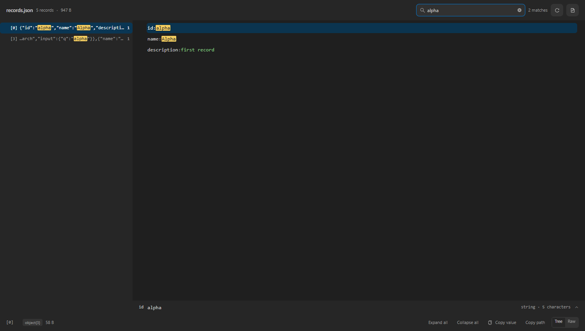
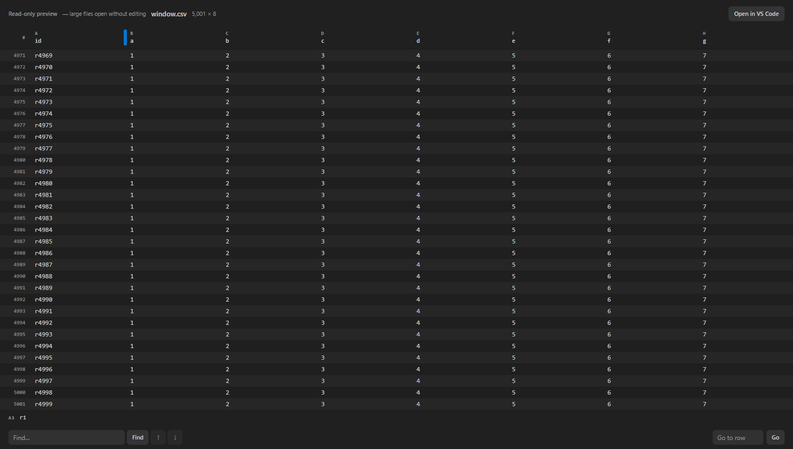
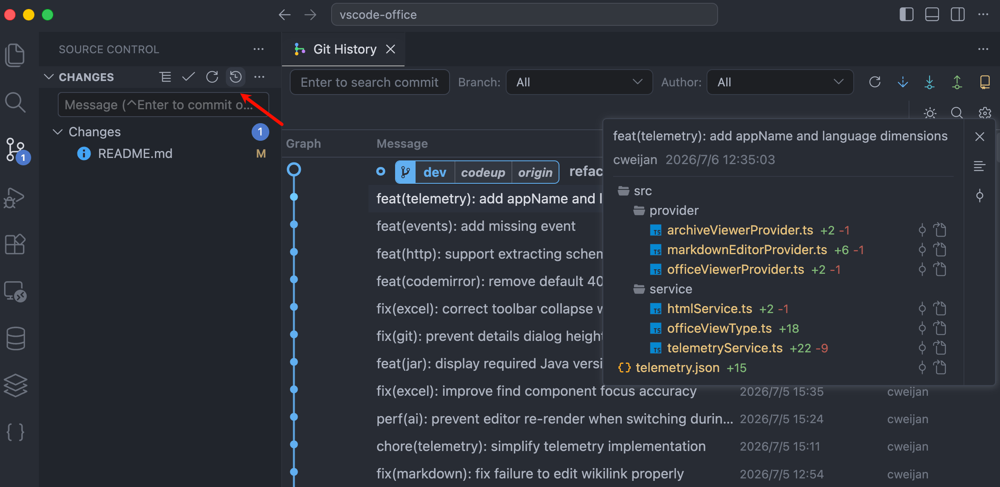

# Data File Viewer (Parquet, JSONL, Excel)

[English](README.md) | 简体中文 | [繁體中文](README-TW.md)

## 介绍

这个扩展在 VS Code 里只预览**三样东西**：

| 格式                                                   | 你能得到什么                                          |
| ------------------------------------------------------ | ----------------------------------------------------- |
| 表格：`.xls`、`.xlsx`、`.xlsm`、`.csv`、`.tsv`、`.ods` | 可编辑网格与查找/替换；大文件进入只读窗口视图         |
| Parquet：`.parquet`                                    | ZSTD/GZIP/BROTLI/LZ4 列、懒加载分页、全文件搜索，只读 |
| JSONL / NDJSON：`.jsonl`、`.ndjson`                    | 左侧条目目录，右侧把选中条目渲染成树或原文            |

就这些。这个 fork 从上游继承的其余格式——Word、PowerPoint、PDF、ePub、字体、图片、PSD、
ICNS、XMind、HTML、Java `.class`、压缩包——都在 **6.0.0** 里删掉了：其中一部分 VS Code
原生已经覆盖，其余的都有更成熟的专用阅读器。理由见
[ADR-0015](docs/adr/0015-narrow-to-three-viewers.md)，升级说明见 [CHANGELOG.md](CHANGELOG.md)。

除此之外还有一个命令式打开的只读 JSON 检查器，用来读大的 `.json` 顶层数组；它不注册
`.json`、不改变默认编辑器，见下面的 [JSON 数组](#json-数组不打开文本编辑器也能读)。

## 本仓库：Data File Viewer (Parquet, JSONL, Excel)（fork）

本仓库 fork 自 [cweijan/vscode-office](https://github.com/cweijan/vscode-office)（MIT，见
[NOTICE.md](NOTICE.md)），以 `GaussAA.office-viewer-plus` 发布，可与原版并存安装。这个 fork
只服务于一个人的数据工作，所以只保留那部分工作真正会用到的格式。

如果同时安装了原版，两者都会声明可以打开同样的表格文件，VS Code 会选其中一个作为默认。想指定时，在标签页上用 **通过以下方式重新打开编辑器…**，或设置 `workbench.editorAssociations`（例如 `{ "*.xlsx": "GaussAA.officeViewer" }`）。最省事的办法是停用原版。

### Parquet：上游打不开的压缩文件

上游打包 `hyparquet` 时没有带解压器，ZSTD 压缩的 parquet 会直接报
`parquet unsupported compression codec: ZSTD`。本 fork 接入了 `hyparquet-compressors`，
SNAPPY / GZIP / BROTLI / ZSTD / LZ4 都能解码。



读取是懒加载的，大文件也不会卡：

- **按页读取**：只解析当前可见的 50 行，377 MB 的文件不再把整张表读进内存。
- **支持时按 Range 取字节**：先用 2 字节探测，支持就只读 footer 和你看的页，否则退回一次性拉取；
  控制台会打印 `[parquet] source: ranged|full`。
- **百万行也能导航**：按行号跳转，页脚显示当前区间（`239,951–240,000 of 250,000`）。
- **按类型渲染**：数字右对齐 + 等宽数字，字符串/布尔/时间戳按主题着色，普通 `BYTE_ARRAY`
  以十六进制显示，null 显示为 `NULL`，点击单元格可查看完整值。
- **结构化单元格有结构感**：JSON 数组/对象（包括 Polars 存成 JSON 字符串的 list 字段）
  会按语法着色，而不是糊成一段字符串。
- **URL 可直接点击**：整个值都是 `http(s)` URL 的单元格会通过扩展宿主在浏览器打开；
  其他协议、带账号密码的 URL 不会被打开。
- **点击左侧字段跳到对应列**：表格水平滚动到该列并留下淡色高亮，不改变行、分页或筛选。



工具栏的 **Find in file** 每列只扫描一遍全文件，带进度、标记命中行、在单元格内高亮匹配文本，
并自动跳到第一条命中；100 万行约 1.3 秒。

查看器跟随 VS Code 主题——包括以前在深色视图下仍是浅色的 antd 控件。没有单独的明暗切换开关。



### JSONL / NDJSON：目录 + 树，而不是表格

一行一个 JSON 值不适合表格，因此提供双栏视图：左侧列出条目，右侧把选中条目渲染成树（或原文）。



- **文件字节不进 webview**：webview 只拿到可见条目的摘要和选中条目的完整值。
- **全文件搜索**：分批流式返回，命中处带上下文片段并高亮。
- **目录读身份，不只看原始开头**：条目有顶层身份键时显示它；身份键是对象时再往里读一层
  （如 `id: { query }`）。
- **长值可以读全，不是截断。** 树是概览：大条目每行固定单行、字符串预览 120 字符；小条目（≤2,000 节点）仍允许叶子换行到 2,000 字符。无论哪种，选中一行后树下方展开值面板，给出全文、路径、类型、字符数与整值复制。节点数超过 2,000 的条目自动退回固定行高虚拟列表，避免极端行卡死界面。
- **上限会说出来。** 单行超过 8 MB 时按原始文本显示而不解析成树；原文超过 1,000,000 字符时明确标为截断；树的 20,000 节点上限也有提示行，而不是无声结束。
- 键盘：`←`/`→` 折叠展开，`Space` 切换，`Enter` 打开或收起值面板，`Ctrl+C` 复制值，`Ctrl+Shift+C` 复制路径，`Esc` 收起面板。



### JSON 数组：不打开文本编辑器也能读

只读检查器，面向顶层是数组或对象的 `.json` 文件。它是命令，不是第四个 viewer：不注册
`.json`、不接管默认编辑器、不写 `contributes.customEditors`。入口是命令面板
（**Data File Viewer: Preview JSON**）、资源管理器右键和 JSON 编辑器标题。



- **大数组只建索引，不整份 parse。** 顶层数组最多 100 MB，按记录边界流式扫描；webview 只为可见行要
  `[index]` 标签，并一次只要一条记录。对象根（最多 20 MB）整份解析。
- **先找记录，再找键。** 全文件搜索返回命中的记录、片段与命中数；选中后加载该记录，展开并高亮第一个
  命中的键；对象根的结果是路径。
- **只接受严格 JSON。** 注释和尾逗号会给出带行列的解析错误，并留一个 **Open in Text Editor** 出口；
  编辑器有未保存修改时优先读 buffer，并在工具栏标明。
- **只读是承诺。** 没有编辑、schema 校验或 JSONC；所有动作最终都回到文本编辑器。
- 键盘：记录列表 `↑`/`↓`/`Home`/`End`；树 `←`/`→`/`Space` 收展、`Enter` 切值面板、
  `Ctrl+C` / `Ctrl+Shift+C` 复制值/路径、`Esc` 清搜索或收面板。



上限：100 MB 数组、20 MB 对象根、单条记录 8 MB（超过按原文显示）、每条原文最多
1,000,000 字符、每次搜索最多 10,000 个命中。记录列表是虚拟列表；树复用 JSONL 的
20,000 节点/每层 200 子项/12 层上限。

### 表格：大文件也能直接看

超过 8 MB 后，CSV/TSV 和工作簿进入只读窗口视图：DOM 里只有视口内的行，21 MB 的 CSV 首屏
约 0.5 s、堆约 33 MB，而可编辑网格需要数秒和数百 MB。查找按块扫全文件，跳行只改滚动偏移，
工作簿带 sheet 选择器。阈值以上要编辑就用文本编辑器（**Open in VS Code**）。



### 验收方式

```bash
pnpm test        # 解析逻辑单测（node:test，不引入额外框架）
pnpm verify:ui   # 无头浏览器 DOM 断言；截图输出到 .ui-verify/shots
pnpm verify:perf # 大文件首屏字节数/耗时与搜索耗时闸门
```

CI 在每次 push 时都会跑这三项，以及 `pnpm build` 和 `pnpm run package`。`pnpm verify:ui --docs`
可刷新上面的截图。

### 已知限制

- 超大文件的 parquet 全文件搜索受 I/O 限制（会读取访问到的每个 row group）。
- parquet 只读，没有写端。
- 表格超过 8 MB 时进入只读窗口视图（只渲染视口内的行）。工作簿超过 15 MB、虚拟工作区里的
  CSV/TSV 超过 25 MB 时先询问再加载；本地 CSV/TSV 最多可窗口化到 200 MB。所有工作簿格式（`.xlsx`、`.xlsm`、`.xls`、`.ods`）都以行文本
  窗口化，所以超过 8 MB 也是只读。
- JSONL 搜索匹配原始文本，不理解 JSON 路径。
- JSONL 单行超过 8 MB 时只按原始文本显示、不解析成树；原文视图只发送前 1,000,000 个字符
  （并明确提示），不会假装那是全文。
- JSONL 的树有上限：20,000 个节点、每层 200 个子项、12 层。截断时树会说出来；要看剩下的
  内容用原文视图。
- 目录窗口按字节（4 MB）而不是行数封顶：由超大行组成的文件只在选中处附近列出少量条目，
  不会为了填满一屏先解析整块。用条目编号跳转；窗口只会向下追加，填不满一屏时末尾有一行
  显式的“加载更多条目”。
- JSON 预览的数组上限 100 MB、对象根上限 20 MB；单条记录超过 8 MB 按原文显示，搜索最多
  10,000 个命中，JSONC/尾逗号会被拒绝。它是命令式面板，窗口重载后不恢复上一次预览的文档，
  需要重新执行命令。
- 上游的遥测已完全移除。

## Git 历史

扩展仍保留 Git 历史工作区（它是提交浏览器，不是文件预览，所以 6.0.0 的范围收窄没有动它）。
可从源代码管理视图、编辑器标题栏、编辑器右键菜单或文件资源管理器右键菜单打开。



## 其他功能

- YAML：文档大纲与锚点导航（别名引用可跳转到定义）
- XML：文档格式化
- 图标主题：8 个 [Material Icon Theme](https://github.com/PKief/vscode-material-icon-theme) 图标，覆盖表格、parquet 与 JSONL

## 开发

```bash
pnpm install
pnpm build        # 生产构建到 out/
pnpm run package  # 打 vsix（需先 build）
pnpm check        # 格式 + lint + 基线 + 类型 + 单测
pnpm check:full   # check + build + smoke + verify:ui + verify:perf
```

在 VS Code 里按 `F5`，选择 **Extension** 运行本地构建。

## 致谢

- 表格解析：[SheetJS/sheetjs](https://github.com/SheetJS/sheetjs)
- 表格渲染：[myliang/x-spreadsheet](https://github.com/myliang/x-spreadsheet)
- Parquet：[hyparquet](https://github.com/hyparam/hyparquet) 与
  [hyparquet-compressors](https://github.com/hyparam/hyparquet-compressors)
- 图标主题：[PKief/vscode-material-icon-theme](https://github.com/PKief/vscode-material-icon-theme)

## Sponsor

[](https://marketplace.visualstudio.com/items?itemName=cweijan.vscode-database-client2)

适用于 Visual Studio Code 的数据库客户端，支持 **MySQL/MariaDB、PostgreSQL、SQLite、Redis**
以及 **ElasticSearch**，也可作为 **SSH** 客户端使用。
[立刻安装](https://marketplace.visualstudio.com/items?itemName=cweijan.vscode-database-client2)。
