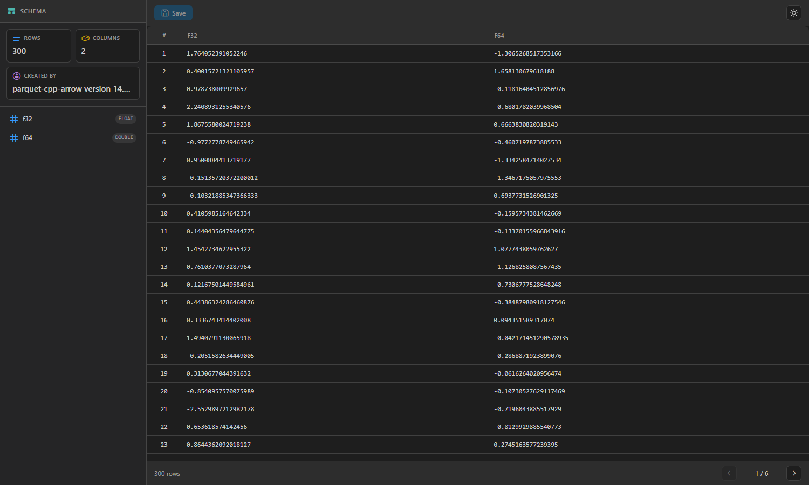
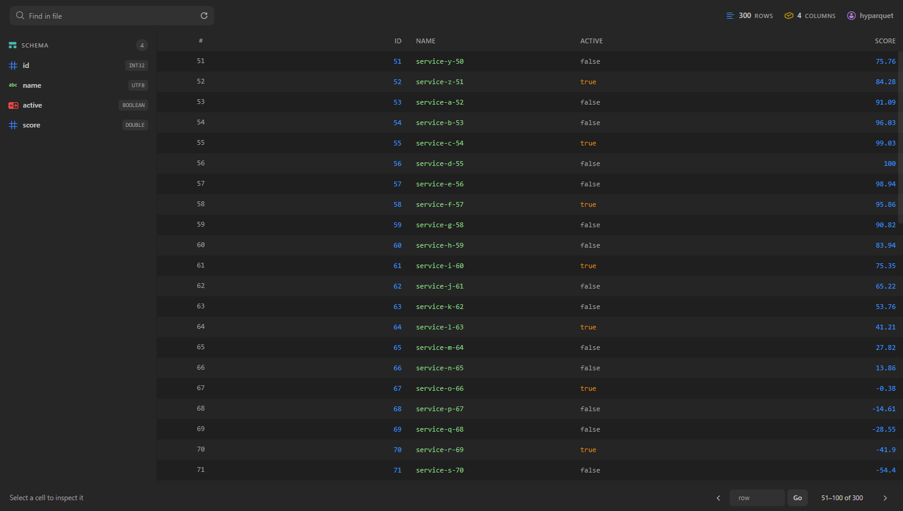
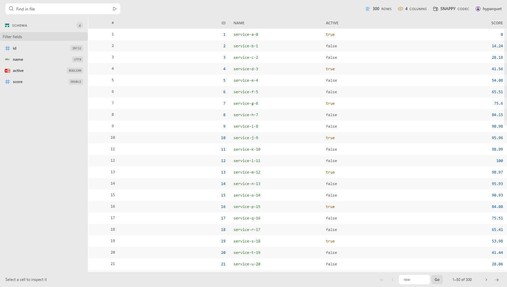
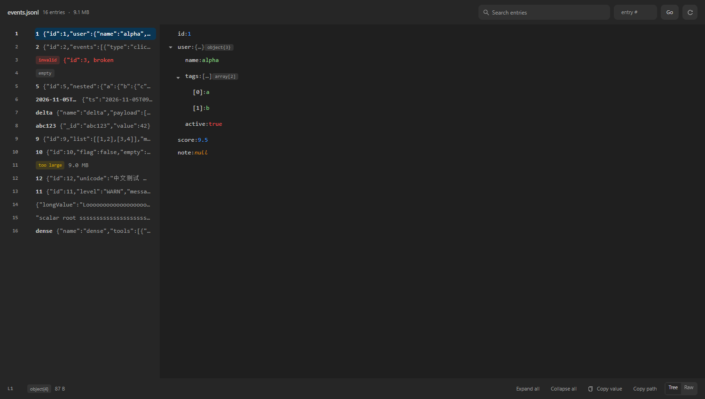
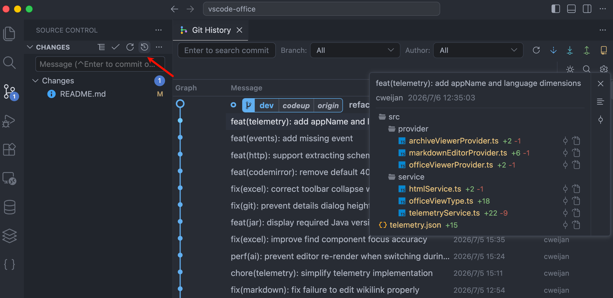

# Office Viewer Plus

[English](README.md) | [简体中文](README-CN.md) | 繁體中文

## 介紹

這個擴充功能在 VS Code 裡只預覽**三種東西**：

| 格式                                                     | 你能得到什麼                                            |
| -------------------------------------------------------- | ------------------------------------------------------- |
| 試算表：`.xls`、`.xlsx`、`.xlsm`、`.csv`、`.tsv`、`.ods` | 可編輯並寫回的格線，含尋找/取代                         |
| Parquet：`.parquet`                                      | ZSTD/GZIP/BROTLI/LZ4 欄位、懶載入分頁、全檔案搜尋，唯讀 |
| JSONL / NDJSON：`.jsonl`、`.ndjson`                      | 左側項目目錄，右側把選取項目呈現為樹狀或原文            |

就這些。這個 fork 從上游繼承的其他格式——Word、PowerPoint、PDF、ePub、字型、圖片、PSD、
ICNS、XMind、HTML、Java `.class`、壓縮檔——都在 **6.0.0** 移除：其中一部分 VS Code
原生已經支援，其餘都有更成熟的專用閱讀器。理由見
[ADR-0015](docs/adr/0015-narrow-to-three-viewers.md)，升級說明見 [CHANGELOG.md](CHANGELOG.md)。

## 本倉庫：Office Viewer Plus（fork）

本倉庫 fork 自 [cweijan/vscode-office](https://github.com/cweijan/vscode-office)（MIT，見
[NOTICE.md](NOTICE.md)），以 `GaussAA.office-viewer-plus` 發佈，可與原版並存安裝。這個 fork
只服務一個人的資料工作，因此只保留那部分工作真正會用到的格式。

### Parquet：上游打不開的壓縮檔案

上游打包 `hyparquet` 時沒有帶解壓器，ZSTD 壓縮的 parquet 會直接報
`parquet unsupported compression codec: ZSTD`。本 fork 接上 `hyparquet-compressors`，
SNAPPY / GZIP / BROTLI / ZSTD / LZ4 都能解碼。



讀取是懶載入的，大檔案也不會卡：

- **按頁讀取**：只解析目前可見的 50 列，377 MB 的檔案不再把整張表讀進記憶體。
- **支援時按 Range 取位元組**：先用 2 位元組探測，支援就只讀 footer 和你看的頁，否則退回
  一次性抓取；主控台會印出 `[parquet] source: ranged|full`。
- **百萬列也能導覽**：按列號跳轉，頁尾顯示目前區間（`239,951–240,000 of 250,000`）。
- **依型別呈現**：數字靠右對齊 + 等寬數字，字串/布林/時間戳依主題著色，null 顯示為 `NULL`，
  點擊儲存格可查看完整值。



工具列的 **Find in file** 以 5000 列為一批掃描整個檔案，帶進度、標記命中的列、在儲存格內
醒目顯示符合的文字，並自動跳到第一筆命中。

檢視器跟隨 VS Code 主題——包括以前在深色檢視下仍是淺色的 antd 控件。沒有獨立的明暗切換開關。



### JSONL / NDJSON：目錄 + 樹狀，而不是表格

一行一個 JSON 值不適合表格，因此提供雙欄檢視：左側列出項目，右側把選取項目呈現為樹狀（或原文）。



- **檔案位元組不進 webview**：webview 只拿到可見項目的摘要和選取項目的完整值。
- **全檔案搜尋**：分批串流回傳，命中處帶上下文片段並醒目顯示。
- **長值換行**而不是截斷；節點數超過 500 的項目自動退回固定列高虛擬清單，避免極端列卡死介面。
- 鍵盤：`←`/`→` 折疊展開，`Space` 切換，`Enter` 複製值，`Ctrl+Shift+C` 複製路徑。

### 驗收方式

```bash
pnpm test        # 解析邏輯單元測試（node:test，不引入額外框架）
pnpm verify:ui   # 無頭瀏覽器 DOM 斷言；截圖輸出到 .ui-verify/shots
```

CI 在每次 push 時都會跑這兩項，以及 `pnpm build` 和 `pnpm run package`。`pnpm verify:ui -- --docs`
可刷新上面的截圖。

### 已知限制

- 超大檔案的 parquet 全檔案搜尋受 I/O 限制（會讀取走訪到的每個 row group）。
- parquet 唯讀，沒有寫入端。
- 表格超過 8 MB 時進入唯讀視窗檢視（只渲染視窗內的行）。活頁簿超過 15 MB、虛擬工作區裡的
  CSV/TSV 超過 25 MB 時先詢問再載入；本機 CSV/TSV 最多可視窗化到 200 MB。
- JSONL 搜尋比對原始文字，不理解 JSON 路徑。
- 上游的遙測已完全移除。

## Git 歷史

擴充功能仍保留 Git 歷史工作區（它是提交瀏覽器，不是檔案預覽，所以 6.0.0 的範圍收窄沒有動它）。
可從原始碼控制檢視、編輯器標題列、編輯器右鍵選單或檔案總管右鍵選單開啟。



## 其他功能

- YAML：文件大綱與錨點導覽（別名引用可跳轉到定義）
- XML：文件格式化
- 圖示主題：8 個 [Material Icon Theme](https://github.com/PKief/vscode-material-icon-theme) 圖示，涵蓋試算表、parquet 與 JSONL

## 開發

```bash
pnpm install
pnpm build        # 生產建置到 out/
pnpm run package  # 打包 vsix（需先 build）
pnpm check        # 格式 + lint + 基線 + 型別 + 單元測試
pnpm check:full   # check + build + smoke + verify:ui
```

在 VS Code 裡按 `F5`，選擇 **Extension** 執行本地建置。

## 致謝

- 試算表解析：[SheetJS/sheetjs](https://github.com/SheetJS/sheetjs)
- 試算表呈現：[myliang/x-spreadsheet](https://github.com/myliang/x-spreadsheet)
- Parquet：[hyparquet](https://github.com/hyparam/hyparquet) 與
  [hyparquet-compressors](https://github.com/hyparam/hyparquet-compressors)
- 圖示主題：[PKief/vscode-material-icon-theme](https://github.com/PKief/vscode-material-icon-theme)

## Sponsor

[](https://marketplace.visualstudio.com/items?itemName=cweijan.vscode-database-client2)

適用於 Visual Studio Code 的資料庫客戶端，支援 **MySQL/MariaDB、PostgreSQL、SQLite、Redis**
以及 **ElasticSearch**，也可作為 **SSH** 客戶端使用。
[立刻安裝](https://marketplace.visualstudio.com/items?itemName=cweijan.vscode-database-client2)。
