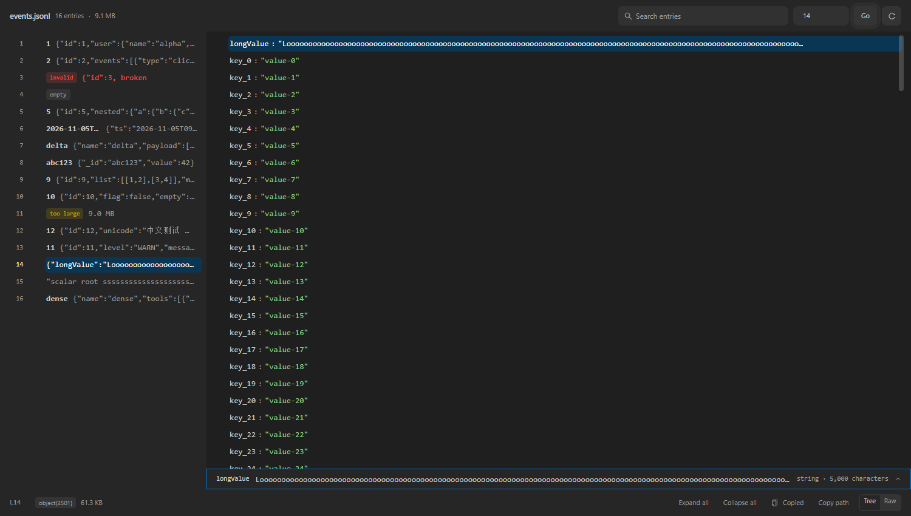
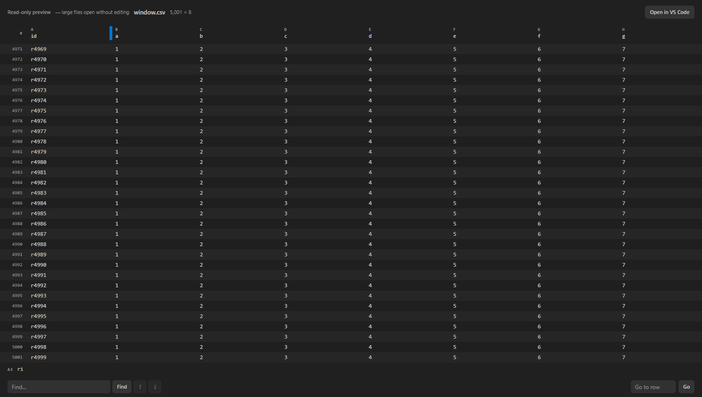

# Data File Viewer (Parquet, JSONL, Excel)

English | [简体中文](README-CN.md) | [繁體中文](README-TW.md)

## Introduction

This extension previews **three things** in VS Code:

| Format                                                         | What you get                                                                 |
| -------------------------------------------------------------- | ---------------------------------------------------------------------------- |
| Spreadsheets: `.xls`, `.xlsx`, `.xlsm`, `.csv`, `.tsv`, `.ods` | Editable grid and find/replace; large files open read-only in a window       |
| Parquet: `.parquet`                                            | ZSTD/GZIP/BROTLI/LZ4 columns, lazy paging, whole-file search, read-only      |
| JSONL / NDJSON: `.jsonl`, `.ndjson`                            | A directory of entries on the left, the selected entry as a tree or raw text |

That is the whole list. Everything else this fork inherited — Word, PowerPoint, PDF, ePub,
fonts, images, PSD, ICNS, XMind, HTML, Java `.class`, archives — was removed in **6.0.0**:
VS Code already covers some of them, and the rest have better dedicated readers. The rationale
is in [ADR-0015](docs/adr/0015-narrow-to-three-viewers.md); the upgrade notes are in
[CHANGELOG.md](CHANGELOG.md).

## This fork

This repository is a fork of [cweijan/vscode-office](https://github.com/cweijan/vscode-office)
(MIT, see [NOTICE.md](NOTICE.md)). It builds as `GaussAA.office-viewer-plus` and installs
alongside the original. The fork is maintained for one person's data work, which is why it only
keeps the formats that work involves.

If both extensions are installed, each one offers to open the same spreadsheet files, so VS Code picks one as the default. To choose, use **Reopen Editor With…** on a tab, or set `workbench.editorAssociations` (for example `{ "*.xlsx": "GaussAA.officeViewer" }`). Disabling the original is the simplest way to avoid the question.

### Parquet: the files upstream cannot open

Upstream bundles `hyparquet` without its decompressors, so a ZSTD-compressed file fails with
`parquet unsupported compression codec: ZSTD`. This fork passes `compressors` from
`hyparquet-compressors`, so SNAPPY, GZIP, BROTLI, ZSTD and LZ4 all decode.


Reading is lazy and stays usable on big files:

- **One page at a time.** Only the visible 50 rows are decoded, so a 377 MB file no longer
  materialises its whole table.
- **Range requests when the host supports them.** A 2-byte probe decides between ranged
  reads (footer plus the pages you look at) and a single full fetch; the console logs
  `[parquet] source: ranged|full`.
- **Navigation for millions of rows.** Jump to any row number; the footer shows the visible
  range (`239,951–240,000 of 250,000`).
- **Type-aware cells.** Numbers are right-aligned with tabular figures, strings, booleans and
  timestamps are coloured from the theme, plain `BYTE_ARRAY` values render as hex, nulls show
  as `NULL`, and clicking a cell opens its full value.
- **Structured cells look structured.** JSON arrays/objects — including list fields that
  Polars stores as a JSON _string_ — are token-coloured instead of one flat string.
- **URLs are links.** A cell whose whole value is `http(s)` opens in the browser through the
  extension host; other schemes and URLs with credentials are never opened.
- **Click a schema field to jump to its column.** The table scrolls horizontally to that
  column and leaves a quiet tint behind, without changing rows or filters.


**Find in file** scans each column once with progress, marks matching rows, highlights the
matching text inside cells, and jumps to the first hit. A 1M-row file scans in about 1.3 s.

The viewer follows the VS Code theme — including the antd widgets, which used to stay light
under a dark view. There is no separate light/dark switch.


### JSONL / NDJSON: a directory, not a grid

One JSON value per line is not a table, so the fork ships a two-pane viewer: the left pane
lists entries, the right pane renders the selected entry as a tree (or as raw text).


- **Bytes stay in the extension host.** The webview receives summaries for the visible
  entries and one full value for the selected entry — never the file.
- **Search across the whole file**, streamed in batches with a snippet around the match and
  the term highlighted.
- **The directory reads identity**, not just the raw head: an entry's top-level identity key
  is used when present, and an object-valued one is looked into one level (`id: { query }`).
- **Long values are readable, not clipped.** The tree is an overview: large entries use one
  fixed-height line per row with a 120-character string preview, while small entries (≤2,000
  nodes) still wrap leaf strings up to 2,000 characters. Either way, selecting a row opens a
  value panel docked under it with the full text, the path, the type, the character count and
  a whole-value copy. Entries above 2,000 nodes fall back to a fixed-height virtual list so a
  pathological line cannot freeze the UI.
- **The limits say so.** A line above 8 MB is shown as raw text instead of a tree; a line above
  1,000,000 characters is a marked prefix; the tree reports its 20,000-node cap instead of
  ending without a word.
- Keyboard: `←`/`→` collapse/expand, `Space` toggles, `Enter` opens or closes the value panel,
  `Ctrl+C` copies the value, `Ctrl+Shift+C` copies the path, `Esc` closes the panel.



### Spreadsheets: large files stay usable

Above 8 MB, CSV/TSV and workbook files open in a read-only windowed table: only the rows the
viewport holds are in the DOM, so a 21 MB CSV paints in ~0.5 s with ~33 MB of heap where the
editable grid needs seconds and hundreds of megabytes. Find scans the file in blocks, "go to
row" only moves the scroll offset, and workbooks keep a sheet picker. Editing above the
threshold stays in the text editor (**Open in VS Code**).



### Verification

```bash
pnpm test        # unit tests for the parsing logic (node:test, no extra framework)
pnpm verify:ui   # headless DOM scenarios; screenshots land in .ui-verify/shots
pnpm verify:perf # byte/time budgets on large files
```

CI runs all three on every push, together with `pnpm build` and `pnpm run package`. Add
`--docs` to `verify:ui` to refresh the screenshots above.

### Known limits

- Whole-file parquet search on a very large file is I/O bound because it reads every row
  group it visits.
- Parquet is read-only; there is no writer.
- Spreadsheets above 8 MB open in a read-only windowed view (viewport rows only). Workbooks
  above 15 MB, and CSV/TSV from a virtual workspace above 25 MB, ask before loading at all;
  a local CSV/TSV may be windowed up to 200 MB. All workbook formats (`.xlsx`, `.xlsm`, `.xls`, `.ods`) are windowed
  as row text, so they are read-only above 8 MB too.
- JSONL search matches raw text, not JSON paths.
- A JSONL line above 8 MB is shown as raw text instead of a parsed tree, and the raw view
  ships the first 1,000,000 characters (with a notice) rather than the whole line.
- The JSONL tree is bounded: 20,000 nodes, 200 children per level, 12 levels. The tree says
  when it stopped; the raw view is the way to see the rest.
- A directory window is bounded by bytes (4 MB), so a file of very large lines shows fewer
  entries around the selection rather than parsing a whole chunk. Use the entry-number field
  to move; the window only appends downward, and a window too short to fill the pane carries
  an explicit "Load more entries" row.
- Upstream telemetry has been removed entirely.

## Git History

The extension still ships the Git History workspace (it is a commit browser, not a file
preview, so the 6.0.0 narrowing did not touch it). Open it from the Source Control view, the
editor title bar, the editor context menu, or the file explorer context menu.


## Other features

- YAML: document outline and anchor navigation (Go to Definition for alias references)
- XML: document formatting
- Icon theme: 8 [Material Icon Theme](https://github.com/PKief/vscode-material-icon-theme) icons for spreadsheets, parquet and JSONL

## Development

```bash
pnpm install
pnpm build        # production build into out/
pnpm run package  # create the .vsix (build first)
pnpm check        # format + lint + baseline + typecheck + unit tests
pnpm check:full   # check + build + smoke + verify:ui + verify:perf
```

Press `F5` in VS Code and choose **Extension** to run the local build.

## Credits

- Spreadsheet parsing: [SheetJS/sheetjs](https://github.com/SheetJS/sheetjs)
- Spreadsheet rendering: [myliang/x-spreadsheet](https://github.com/myliang/x-spreadsheet)
- Parquet: [hyparquet](https://github.com/hyparam/hyparquet) and
  [hyparquet-compressors](https://github.com/hyparam/hyparquet-compressors)
- Material Icon theme: [PKief/vscode-material-icon-theme](https://github.com/PKief/vscode-material-icon-theme)

## Sponsor

[](https://marketplace.visualstudio.com/items?itemName=cweijan.vscode-database-client2)

Database Client for Visual Studio Code, supporting **MySQL/MariaDB, PostgreSQL, SQLite, Redis**
and **ElasticSearch**, and working as an **SSH** client.
[Get it now](https://marketplace.visualstudio.com/items?itemName=cweijan.vscode-database-client2).
