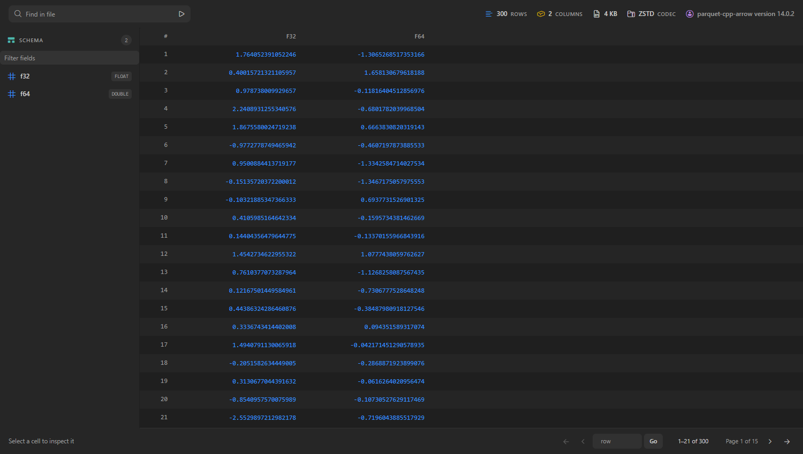
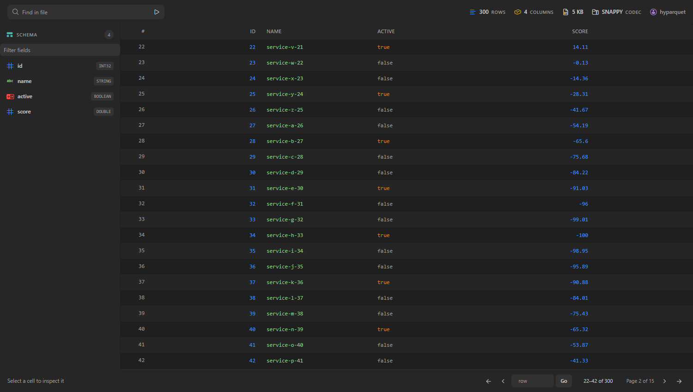
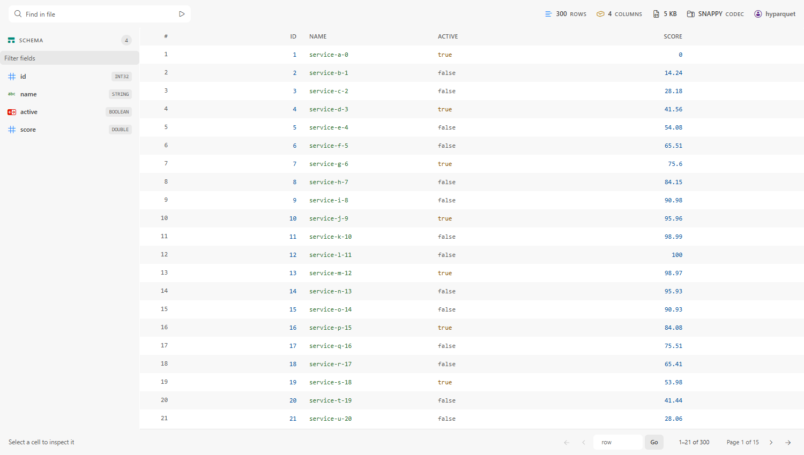
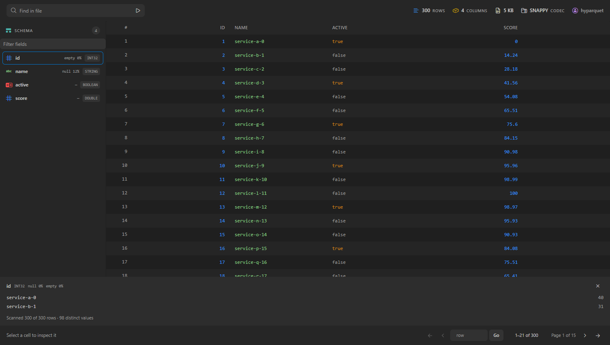
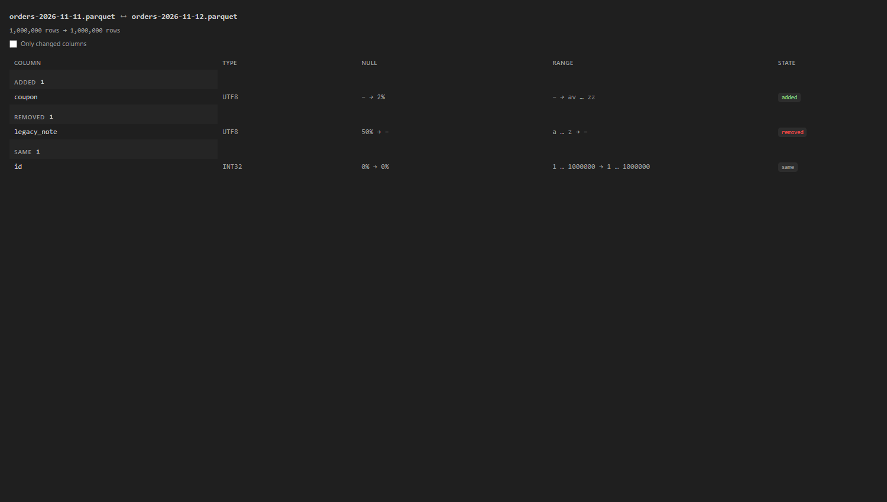
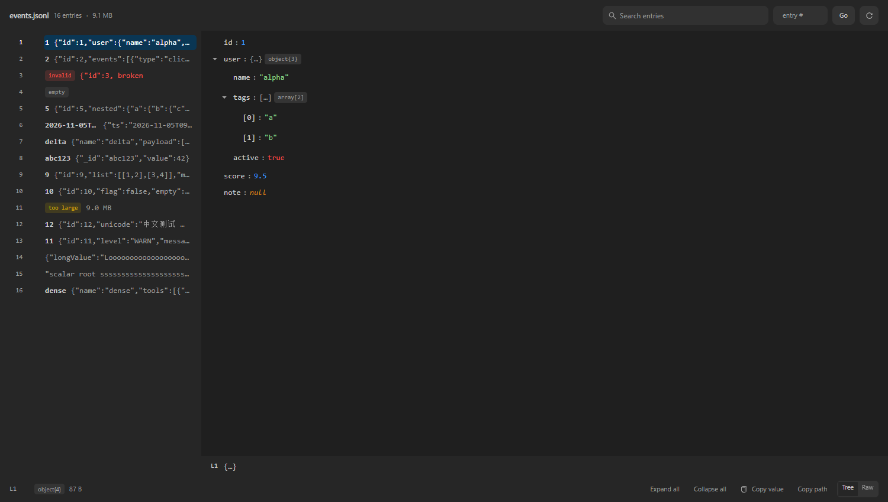
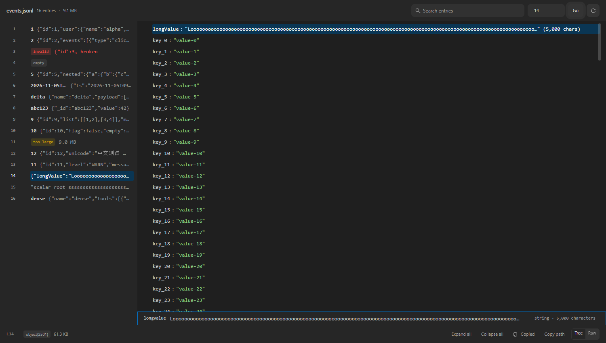
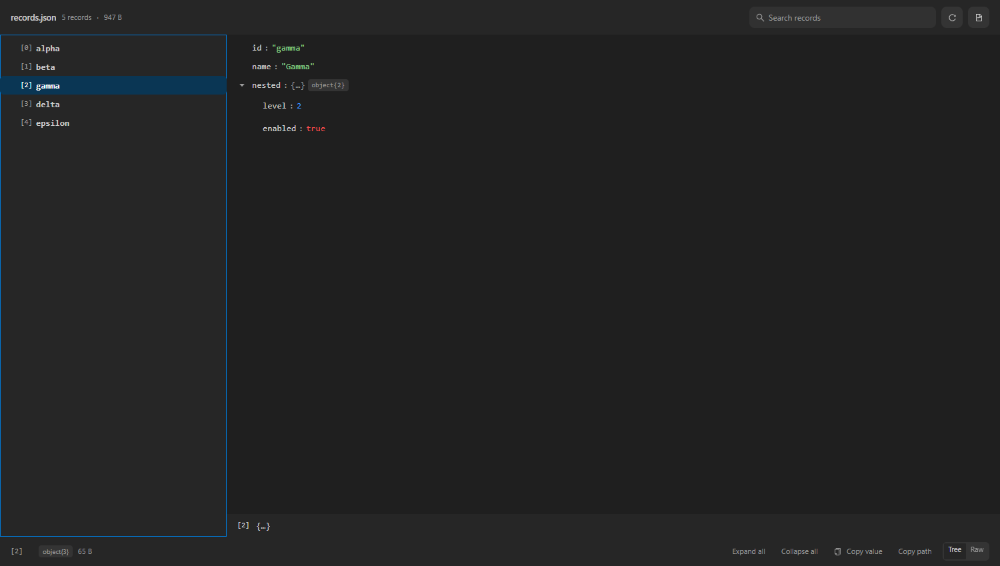
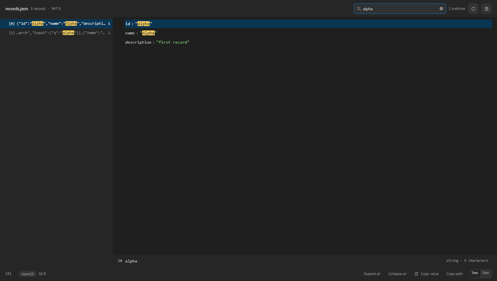

# Data File Viewer (Parquet, JSONL)

English | [简体中文](README-CN.md) | [繁體中文](README-TW.md)

## Introduction

This extension previews **two things** in VS Code:

| Format                              | What you get                                                                                                    |
| ----------------------------------- | --------------------------------------------------------------------------------------------------------------- |
| Parquet: `.parquet`                 | ZSTD/GZIP/BROTLI/LZ4 columns, lazy paging, host-side scoped search, pinned/just-the-selected columns, read-only |
| JSONL / NDJSON: `.jsonl`, `.ndjson` | A directory of entries on the left, the selected entry as a tree or raw text                                    |

That is the whole list. Everything else this fork inherited — Word, PowerPoint, PDF, ePub, fonts,
images, PSD, ICNS, XMind, HTML, Java `.class`, archives — was removed in **6.0.0**: VS Code
already covers some of them, and the rest have better dedicated readers
([ADR-0015](docs/adr/0015-narrow-to-three-viewers.md)). The editable spreadsheet viewer
(`.xls`, `.xlsx`, `.xlsm`, `.csv`, `.tsv`, `.ods`) was removed in **7.0.0**
([ADR-0029](docs/adr/0029-narrow-to-two-viewers.md)): `.csv`/`.tsv` open in VS Code's own text
editor, and the workbook formats are left to Office/WPS instead of a second parser here.

Beyond the two viewers, a command-opened read-only JSON inspector handles large `.json` arrays
without registering `.json` or changing the default editor; see
[JSON arrays](#json-arrays-inspect-without-the-text-editor).

## This fork

This repository is a fork of [cweijan/vscode-office](https://github.com/cweijan/vscode-office)
(MIT, see [NOTICE.md](NOTICE.md)). It builds as `GaussAA.office-viewer-plus` and installs
alongside the original. The fork is maintained for one person's data work, which is why it only
keeps the formats that work involves.

### Parquet: the files upstream cannot open

Upstream bundles `hyparquet` without its decompressors, so a ZSTD-compressed file fails with
`parquet unsupported compression codec: ZSTD`. This fork passes `compressors` from
`hyparquet-compressors`, so SNAPPY, GZIP, BROTLI, ZSTD and LZ4 all decode.



Reading is lazy and stays usable on big files:

- **One page at a time.** Only the visible 50 rows are decoded, so a 377 MB file no longer
  materialises its whole table.
- **Range requests when the host supports them.** A 2-byte probe decides between ranged
  reads (footer plus the pages you look at) and a single full fetch; the console logs
  `[parquet] source: ranged|full`.
- **Navigation for millions of rows.** Jump to any row number; the footer shows the visible
  range (`239,951–240,000 of 250,000`).
- **Type-aware cells.** Numbers are right-aligned with tabular figures, strings, booleans and
  timestamps are coloured from the theme, plain `BYTE_ARRAY` values render as hex, nulls show
  as `NULL`, and clicking a cell opens its full value.
- **Structured cells look structured.** JSON arrays/objects — including list fields that
  Polars stores as a JSON _string_ — are token-coloured instead of one flat string.
- **URLs are links.** A cell whose whole value is `http(s)` opens in the browser through the
  extension host; other schemes and URLs with credentials are never opened.
- **Click a schema field to jump to its column.** The table scrolls horizontally to that
  column and leaves a quiet tint behind, without changing rows or filters. When the column is
  about to scroll out of view it pins to that edge, with a pin marker and a shadow; scroll it
  back and it returns to the flow. Cell clicks tint but never pin.
- **Select columns, then show only those.** Ctrl/Cmd-click adds columns, Shift-click selects a
  range, and the sidebar's “only selected” switch narrows the table without touching column
  widths. Clicking a hidden field brings it back. The checked set persists per file.
- **A column profile in the sidebar.** Each field reports its share of null rows, read from the
  file's row-group statistics — footer metadata, never a column decode. A file written without
  statistics says so instead of showing `0%`, a partial answer is labelled partial, and a nested
  column is left unprofiled because leaf statistics do not describe a row. Click the badge (or
  press `i` on the focused field) for that column's top values and counts: the scan decodes only
  that column, stops after 200,000 rows, and the panel says how much it covered.



**Find in file** runs in the extension host, so a large file keeps the UI responsive. Choose
**all columns**, the **current column**, or the **visible columns** next to the search box; a
139 MB / 269k-row file with a 122 MB text column takes about 0.4 s for one column instead of
12–17 s for all of them. Hits get three layers — highlighted text, a marked row, and the matched
column — and a hit in a column hidden by “only selected” is reported with a one-click reveal.

The viewer follows the VS Code theme — including the antd widgets, which used to stay light
under a dark view. There is no separate light/dark switch.





### Comparing two parquet files

Two files, one table. The command picks a left and a right file and shows each column's null
share and range on both sides, grouped by what happened: added, removed, type changed, changed,
cannot compare, same. It reads only each file's footer — no column is decoded and no rows are
compared — so a pair of 377 MB files still opens instantly.

A row-count difference is a finding in the header, not an error, and a side written without
statistics says "cannot compare" instead of pretending nothing moved.



### JSONL / NDJSON: a directory, not a grid

One JSON value per line is not a table, so the fork ships a two-pane viewer: the left pane
lists entries, the right pane renders the selected entry as a tree (or as raw text).



- **Bytes stay in the extension host.** The webview receives summaries for the visible
  entries and one full value for the selected entry — never the file.
- **Search across the whole file**, streamed in batches with a snippet around the match and
  the term highlighted. A hit inside a long value is shown in the tree summary too: the summary
  is centred on the first match instead of always starting at character zero.
- **The directory reads identity**, not just the raw head: an entry's top-level identity key
  is used when present, and an object-valued one is looked into one level (`id: { query }`).
- **One summary number: 120 characters.** Every value summary is a single line capped at 120
  characters and marked `… (N chars)` — tree rows, the detail header, the Raw tab, the directory
  labels and search snippets all read the same constant. There is no wrap mode; entries of every
  size use a fixed-height virtual list, so a pathological line cannot freeze the UI.
- **The value panel is the only full-text channel.** Selecting a value opens a docked panel
  under the tree with the full text, the path, the type and the character count. It renders by
  line, shows up to 4,000,000 characters of the value, expands to the full pane height, and
  `Copy value` always copies the whole value. Lines that cannot be parsed (`invalid`) or are
  above the 8 MB parse limit (`too-large`) read their raw text in the same panel instead of
  flooding the body.
- **The limits say so.** A line above 8 MB is shown as raw text instead of a tree; the raw text
  is capped at 1,000,000 characters with a notice; the tree reports its 20,000-node cap instead
  of ending without a word.
- Keyboard: `←`/`→` collapse/expand, `Space` toggles, `Enter` opens or closes the value panel,
  `Ctrl+C` copies the value, `Ctrl+Shift+C` copies the path, `Esc` closes the panel.



### JSON arrays: inspect without the text editor

A read-only inspector for `.json` files whose top-level value is an array or an object. It is a
command, not a viewer: it does not register `.json`, does not take over the default editor, and
never appears in `contributes.customEditors`. Open it from the command palette
(**Data File Viewer: Preview JSON**), the Explorer context menu, or the JSON editor title.



- **Big arrays are indexed, not parsed whole.** A top-level array up to 100 MB is scanned for
  record boundaries; the webview asks for `[index]` labels for the visible rows and for one
  record at a time. Object roots (up to 20 MB) are parsed whole.
- **Find the record, then the key.** Whole-file search returns matching records with snippets
  and counts; selecting a result loads that record and expands/highlights the first matching
  key. For object roots the results are paths.
- **Strict JSON only.** Comments and trailing commas are an explicit parse error with a line
  and column, plus an **Open in Text Editor** exit. An unsaved editor buffer wins and is
  labelled in the toolbar.
- **Read-only, by contract.** There is no editing path, no schema validation, no JSONC; every
  action ends in the text editor.
- **The same summary and value panel as JSONL.** 120-character summaries, the docked value panel
  as the only full-text channel (4,000,000 characters), a hit-centred summary.
- Keyboard: `↑`/`↓`/`Home`/`End` in the record list; `←`/`→`/`Space` expand and collapse the
  record tree; `Enter` toggles the value panel; `Ctrl+C` / `Ctrl+Shift+C` copy the value/path;
  `Esc` clears the search or closes the value panel.



Limits: 100 MB arrays, 20 MB object roots, 8 MB per record (above that the record is raw
text), 1,000,000 characters of raw text per record, 4,000,000 characters in the value panel,
and 10,000 matches per search. The record list is virtual; the tree reuses the JSONL bounds
(20,000 nodes, 200 children per level, 12 levels).

### Verification

```bash
pnpm test        # unit tests for the parsing logic (node:test, no extra framework)
pnpm verify:ui   # headless DOM scenarios; screenshots land in .ui-verify/shots
pnpm verify:perf # byte/time budgets on large files
```

CI runs all three on every push, together with `pnpm build` and `pnpm run package`. Add
`--docs` to `verify:ui` to refresh the screenshots above.

### Non-goals

- Parquet stays read-only: there is no writer.
- JSONL search matches raw text, not JSON paths.
- No spreadsheet or Office preview: `.xls`, `.xlsx`, `.xlsm`, `.ods`, `.csv` and `.tsv` are not
  opened by this extension (CSV/TSV fall back to VS Code's text editor).

### Known gaps

- Whole-file parquet search on a very large file is I/O bound because it reads every row
  group it visits.
- A JSONL line above 8 MB is shown as raw text instead of a parsed tree, and the raw text is
  capped at 1,000,000 characters (with a notice) rather than the whole line.
- The JSONL tree is bounded: 20,000 nodes, 200 children per level, 12 levels. The tree says
  when it stopped; the value panel is how you read the rest of a value.
- A directory window is bounded by bytes (4 MB), so a file of very large lines shows fewer
  entries around the selection rather than parsing a whole chunk. Use the entry-number field
  to move; the window only appends downward, and a window too short to fill the pane carries
  an explicit "Load more entries" row.
- The JSON preview stops at 100 MB for a top-level array and 20 MB for an object root; a
  single record above 8 MB is raw text, the value panel stops at 4,000,000 characters, search
  stops at 10,000 matches, and JSONC/trailing commas are rejected. It is a command-opened
  panel, so a window reload does not restore the last previewed document; use the command again.
- Spreadsheets are not previewed at all: `.xlsx/.xlsm/.xls/.ods` have no fallback inside
  VS Code, and `.csv/.tsv` open as text.

Upstream telemetry has been removed entirely.

#### Other features

- YAML: document outline and anchor navigation (Go to Definition for alias references)
- XML: document formatting
- Icon theme: 8 [Material Icon Theme](https://github.com/PKief/vscode-material-icon-theme) icons
  for spreadsheets, parquet and JSONL files (the icons still identify those files even though
  the spreadsheet viewer is gone)

## Development

```bash
pnpm install
pnpm build        # production build into out/
pnpm run package  # create the .vsix (build first)
pnpm check        # format + lint + baseline + typecheck + unit tests
pnpm check:full   # check + build + smoke + verify:ui + verify:perf
```

Press `F5` in VS Code and choose **Extension** to run the local build.

## Credits

- Parquet: [hyparquet](https://github.com/hyparam/hyparquet) and
  [hyparquet-compressors](https://github.com/hyparam/hyparquet-compressors)
- Material Icon theme: [PKief/vscode-material-icon-theme](https://github.com/PKief/vscode-material-icon-theme)

The original project was funded by [Database Client](https://database-client.com/) (Weijan Chen),
which is why upstream ships a floating "Supported by Database Client" bar in every viewer. This
fork removed that bar in 6.6.0 — it sat on top of the parquet pager — and keeps the credit here
and in [NOTICE.md](NOTICE.md) instead.
