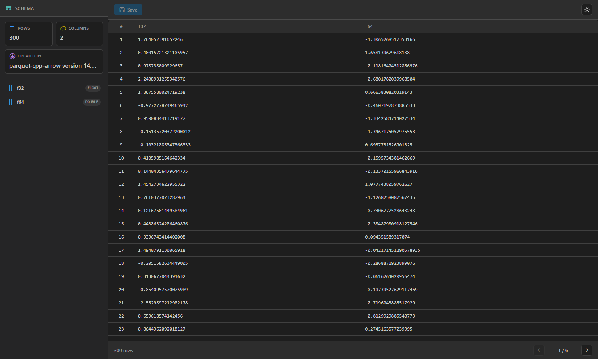
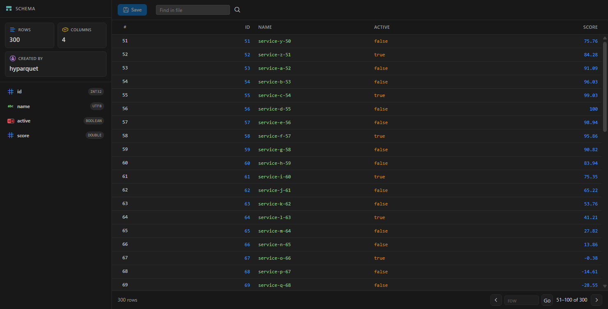
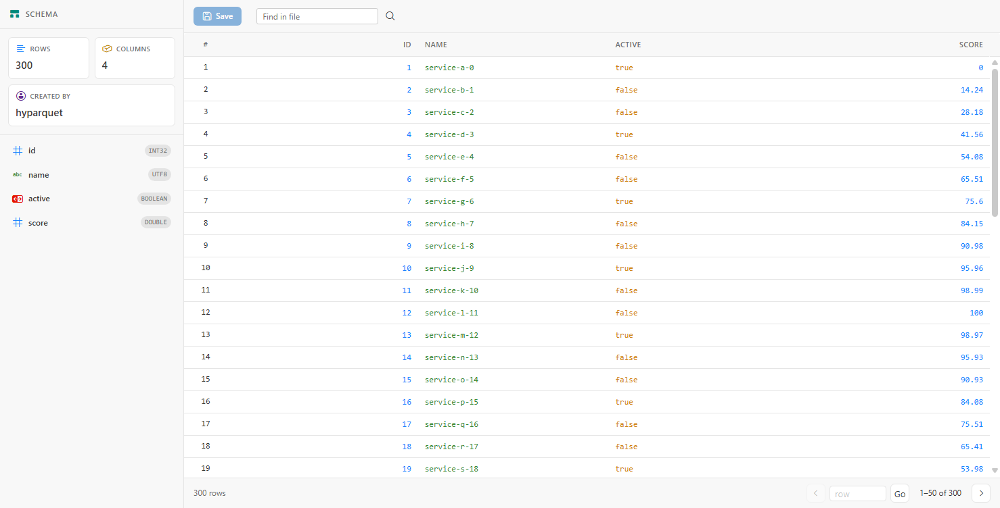
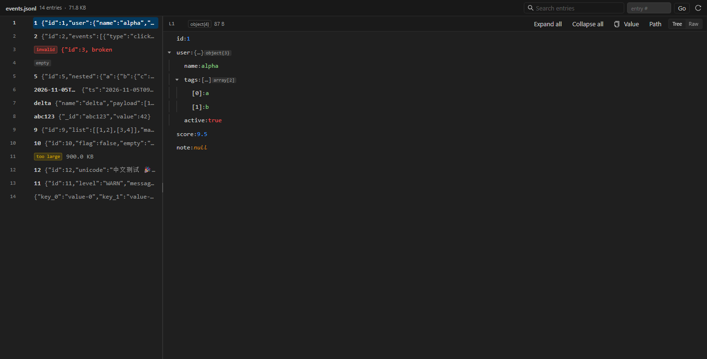
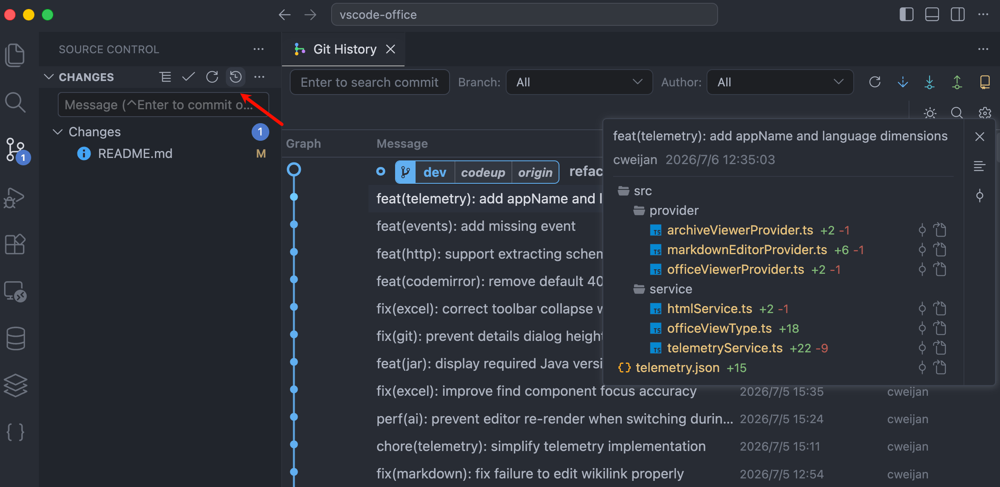
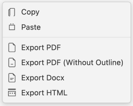

# Office Viewer

English | [简体中文](README-CN.md) | [繁體中文](README-TW.md)

## Introduction

This extension lets you preview and edit common office and design files directly in VS Code.

- Excel: `.xls`, `.xlsx`, `.xlsm`, `.csv`, `.ods`
- Word: `.docx`, `.dotx`
- PowerPoint: `.pptx`, `.pptm`
- PDF & eBook: `.pdf`, `.epub`
- HEIC/TIFF: `.heic`, `.heif`, `.tiff`
- Design: `.psd`, `.xmind`, `.icns`, `.svg`
- Font: `.ttf`, `.otf`, `.woff`, `.woff2`
- Markdown: `.md`, `.markdown`
- HTML: `.html`, `.htm`
- HTTP request: `.http`, `.rest`
- Java: `.class` (decompiler)
- Compressed files: `.zip`, `.jar`, `.vsix`, `.rar`, `.7z`, `.tar`, `.tar.gz`, `.tgz`, `.apk`

## This fork: Office Viewer Plus

This repository is a fork of [cweijan/vscode-office](https://github.com/cweijan/vscode-office)
(MIT, see [NOTICE.md](NOTICE.md)). It builds as `chaowu21.office-viewer-plus` and installs
alongside the original, so everything above still works. The fork adds:

### Parquet: the files upstream cannot open

Upstream bundles `hyparquet` without its decompressors, so a ZSTD-compressed file fails with
`parquet unsupported compression codec: ZSTD`. This fork passes `compressors` from
`hyparquet-compressors`, so SNAPPY, GZIP, BROTLI, ZSTD and LZ4 all decode.



Reading is lazy and stays usable on big files:

- **One page at a time.** Only the visible 50 rows are decoded, so a 377 MB file no longer
  materialises its whole table. Edits are recorded per absolute row and re-applied when a
  page is shown.
- **Range requests when the host supports them.** A 2-byte probe decides between ranged
  reads (footer plus the pages you look at) and a single full fetch; the console logs
  `[parquet] source: ranged|full`.
- **Large files open read-only.** Saving re-reads the file, so above 200,000 rows editing is
  disabled with an explanation instead of failing later.
- **Navigation for millions of rows.** Jump to any row number; the footer shows the visible
  range (`239,951–240,000 of 250,000`).
- **Type-aware cells.** Numbers are right-aligned with tabular figures, strings, booleans and
  timestamps are coloured from the theme, nulls render as `NULL`, edited cells are marked,
  and clicking a cell opens its full value.



**Find in file** scans in 5,000-row batches with progress, marks matching rows, highlights
the matching text inside cells, and jumps to the first hit. Matches are marked with an opaque
amber chip rather than a translucent wash, so a hit stays readable on top of the coloured
values underneath.

The viewer follows the VS Code theme — including the antd widgets, which used to stay light
under a dark view. There is no separate light/dark switch.



### JSONL / NDJSON: a directory, not a grid

One JSON value per line is not a table, so the fork ships a two-pane viewer: the left pane
lists entries, the right pane renders the selected entry as a tree (or as raw text).



- **Bytes stay in the extension host.** The webview receives summaries for the visible
  entries and one full value for the selected entry — never the file.
- **Search across the whole file**, streamed in batches with a snippet around the match and
  the term highlighted.
- **Long values wrap** instead of being clipped, and entries above 500 nodes fall back to a
  fixed-height virtual list so a pathological line cannot freeze the UI.
- Keyboard: `←`/`→` collapse/expand, `Space` toggles, `Enter` copies the value,
  `Ctrl+Shift+C` copies the path.

### Verification

```bash
pnpm test        # unit tests for the parsing logic (node:test, no extra framework)
pnpm verify:ui   # headless DOM scenarios; screenshots land in .ui-verify/shots
```

CI runs both on every push, together with `pnpm build` and `pnpm run package`. Add
`-- --docs` to `verify:ui` to refresh the screenshots above. Design rationale lives in
[docs/adr/0001-fork-office-viewer.md](docs/adr/0001-fork-office-viewer.md).

### Known limits

- Saving a non-SNAPPY parquet rewrites it as SNAPPY (the writer supports nothing else) and
  warns first.
- Parquet files above 200,000 rows are read-only; whole-file search on a very large file is
  I/O bound because it reads every row group it visits.
- JSONL search matches raw text, not JSON paths.
- Upstream telemetry has been removed entirely.

## Git History

Office Viewer includes a full Git History workspace for exploring repositories without leaving VS Code. Open it from the Source Control view, the editor title bar, the editor context menu, or the file explorer context menu.



## Markdown

This extension replaces the default Markdown editor with a WYSIWYG editor.

To use the built-in VS Code Markdown editor instead, add this to your `settings.json`:

```json
{
    "workbench.editorAssociations": {
        "*.md": "default",
        "*.markdown": "default"
    }
}
```

Right-click in the editor to export Markdown to PDF, DOCX, or HTML. PDF export requires Chromium; set the browser path with `vscode-office.chromiumPath`.



Shortcuts: Based on [shortcut.md](shortcut.md), plus:

- New line: `Ctrl+Enter` / `⌘ Enter`
- Hard line break: `Shift+Enter` / `⇧ Enter`
- Edit hyperlink: `Alt+Enter` / `^ Enter`
- Set CodeMirror language: `Alt+Enter` / `^ Enter`
- Edit in VS Code: `Ctrl Alt E` / `⌘ ^ E`
- Paste as plain text: `Ctrl+Shift+V` / `⌘ ⇧ V`

## Other features

- HTML: live preview while editing; press `Ctrl+Shift+V` to open the live view
- YAML: document outline and anchor navigation (Go to Definition for alias references)
- Icon theme: includes a subset of [Material Icon Theme](https://github.com/PKief/vscode-material-icon-theme) icons, plus **Office Material Icon Theme** and **One Dark Modern** color themes
- Excel: preview and save `.xlsx`, `.xls`, `.xlsm`, `.csv`, and `.ods` files
- HTTP: send requests from `.http` and `.rest` files (integrated from [REST Client](https://github.com/Huachao/vscode-restclient) with fixes for local request issues); press `Ctrl+Enter` / `⌘ Enter` to send
- Java: decompile and view `.class` files

## Sponsor

[](https://marketplace.visualstudio.com/items?itemName=cweijan.vscode-database-client2)

Database Client for Visual Studio Code, supporting the management of **MySQL/MariaDB, PostgreSQL, SQLite, Redis**, and **ElasticSearch**, and works as an **SSH** client to boost your productivity! [Get it now](https://marketplace.visualstudio.com/items?itemName=cweijan.vscode-database-client2).

## Development Guide

### Prerequisites

- [Node.js](https://nodejs.org/) 18+
- [VS Code](https://code.visualstudio.com/) 1.64+

### Getting started

```bash
git clone https://github.com/cweijan/vscode-office.git
cd vscode-office
npm install
```

### Development

**Desktop extension** (full feature set):

```bash
npm run dev
```

Press `F5` in VS Code, or choose **Extension** from Run and Debug.

**Web extension** (Markdown, HTML, YAML in the browser):

```bash
npm run dev:web
```

Choose **Extension (Web)** from Run and Debug.

### Build & package

```bash
npm run build    # production build
npm run package  # create .vsix
```

## Usage data

Office Viewer collects **anonymous usage data** to understand which preview features are used, so we can improve the extension. Data is sent to [Azure Application Insights](https://learn.microsoft.com/azure/azure-monitor/app/app-insights-overview) via the official [`@vscode/extension-telemetry`](https://www.npmjs.com/package/@vscode/extension-telemetry) module.

### What we collect

| Event         | When                              | Properties                                                                                                 |
| ------------- | --------------------------------- | ---------------------------------------------------------------------------------------------------------- |
| `view.open` | A custom preview/editor is opened | `viewType` (e.g. `excel`, `markdown`, `pdf`), `fileType` (extension only, e.g. `xlsx`, `md`) |

We **do not** collect file paths, file names, URLs, repository names, request contents, or other personally identifiable information.

### How to opt out

Telemetry is sent only when **both** of the following allow it:

1. VS Code global telemetry is enabled (`telemetry.telemetryLevel` is not `off`, or `telemetry.enableTelemetry` is `true` on older versions).
2. Extension telemetry is enabled: set `vscode-office.enableTelemetry` to `false` in Settings.

You can also disable all VS Code telemetry in **Settings → Application → Telemetry**.

### Maintainer setup

If you build and publish this extension yourself, see [docs/telemetry.md](docs/telemetry.md) for Azure Application Insights setup and sample queries.

## Credits

- PDF rendering: [mozilla/pdf.js](https://github.com/mozilla/pdf.js/)
- DOCX rendering: [VolodymyrBaydalka/docxjs](https://github.com/VolodymyrBaydalka/docxjs)
- PPTX rendering: [pptxviewjs](https://www.npmjs.com/package/pptxviewjs)
- XLSX rendering:
  - [SheetJS/sheetjs](https://github.com/SheetJS/sheetjs): XLSX parsing
  - [myliang/x-spreadsheet](https://github.com/myliang/x-spreadsheet): XLSX rendering
- EPUB: [futurepress/epub.js](https://github.com/futurepress/epub.js)
- PSD: [ag-psd](https://github.com/Agamnentzar/ag-psd)
- XMind: [mind-elixir](https://github.com/ssshooter/mind-elixir-core), [@mind-elixir/import-xmind](https://github.com/ssshooter/mind-elixir-core)
- HEIC conversion: [heic2any](https://github.com/alexcorvi/heic2any)
- Java decompiler: [JetBrains/java-decompiler](https://github.com/JetBrains/intellij-community/tree/master/plugins/java-decompiler/engine)
- HTTP: [REST Client](https://github.com/Huachao/vscode-restclient)
- Markdown: [Vanessa219/vditor](https://github.com/Vanessa219/vditor)
- Material Icon theme: [PKief/vscode-material-icon-theme](https://github.com/PKief/vscode-material-icon-theme)
